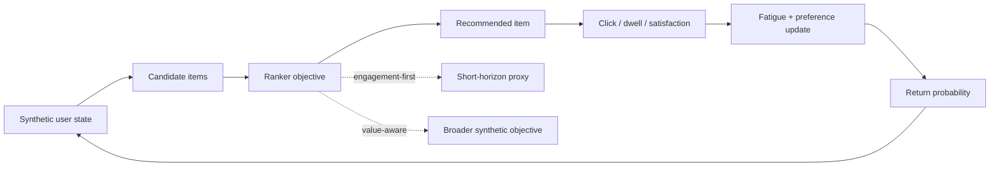

# Recommender Objective Lab

A reproducible **synthetic experiment** about objective design in recommender systems: what changes when a ranker optimizes short-term engagement instead of a broader proxy for long-term user value?

> The repository is a mechanism-demonstration and reproducibility artifact. It is **not** a calibrated model of YouTube, TikTok, X, Pinterest, or any other real platform.

## The question

A recommender rarely optimizes an abstract notion of "what is good for the user" directly. It optimizes measurable proxies. This project asks a narrower technical question:

**If an observable engagement proxy and a broader synthetic value objective are not identical, can optimizing them lead to systematically different trajectories?**

The two endpoint objectives are:

```python
engagement_score = (
    0.58 * p_click
    + 0.42 * normalized_dwell
)
```

and:

```python
value_score = (
    0.38 * p_click
    + 0.47 * latent_satisfaction
    + 0.15 * novelty
)
```

A continuous sweep interpolates between them with `alpha ∈ [0, 1]`.

## Experiment loop



The environment contains delayed effects: repeated exposure may create category-specific fatigue, consumed content may slightly shift current preferences, and session return probability depends on the resulting synthetic experience.

## Reference result

Using the `article` preset (**20 seeds × 400 users**), the baseline simulation produces approximately:

| Metric | Engagement-first | Value-aware |
|---|---:|---:|
| CTR | **0.702** | 0.607 |
| Satisfaction | 0.682 | **0.908** |
| Mean sessions | 7.53 | **8.83** |
| Diversity | 0.358 | **0.498** |
| Fatigue | 0.153 | **0.129** |
| Preference drift | 0.254 | **0.147** |

These are **model outputs**, not estimates of real platform metrics. The interesting result is the trade-off: the engagement-first policy wins on the metric it was designed to maximize, while the value-aware policy performs better on the broader synthetic outcomes.

### Objective trade-off


The repository's plotting pipeline also generates the objective-mix curve, sensitivity heatmaps and ablation plots used in analysis.

A particularly informative ablation removes fatigue. In the baseline model the value-aware advantage in satisfaction is large; once fatigue is removed, the gap becomes much smaller. Under these assumptions, delayed consumption costs are therefore an important mechanism behind the short-vs-long-horizon divergence.

## What is tested

The repository includes:

- baseline comparison of two ranking objectives;
- **20-seed** robustness analysis;
- one-factor-at-a-time sensitivity analysis;
- ablations for preference drift, fatigue, novelty and actual/ideal preference alignment;
- continuous objective sweep `alpha ∈ [0, 1]`;
- article-facing CSV tables;
- reproducible figures;
- explicit claim and interpretation boundaries.

## Repository layout

```text
.
├── src/recommender_objective_lab/
│   ├── simulation.py      # synthetic environment and rankers
│   ├── experiments.py     # baseline, sensitivity, ablations, alpha sweep
│   ├── plotting.py        # article figures
│   └── cli.py             # reproducible CLI
├── tests/
├── docs/
│   ├── methodology.md
│   └── claim-boundaries.md
├── results/reference/     # curated reference outputs
├── REFERENCES.md
├── pyproject.toml
└── Makefile
```

## Reproduce

Python 3.10+.

```bash
python -m venv .venv
source .venv/bin/activate
python -m pip install -e ".[dev]"
```

Fast smoke run:

```bash
python -m recommender_objective_lab --preset quick --out results/quick
```

Reference/article configuration:

```bash
python -m recommender_objective_lab --preset article --out results/article
```

Equivalent Make targets:

```bash
make quick
make reproduce
```

Runs are parallelized across independent configurations by default (up to 4 worker processes); use `--jobs 1` for fully sequential execution.

The `article` preset uses:

- 20 random seeds;
- 400 users per seed;
- 12 possible sessions;
- 5 recommendation opportunities per session;
- 8 content categories;
- 1,200 synthetic items;
- 20 candidates per recommendation.

## Test

```bash
python -m pytest -q
```

## Interpretation boundary

This experiment can demonstrate a **possible mechanism under explicit assumptions**. It does **not** demonstrate that:

- a named social platform manipulates users;
- engagement optimization is inherently harmful;
- real preference formation follows the equations used here;
- the synthetic satisfaction function is the ethically correct definition of welfare;
- the chosen coefficients are production-optimal.

Read [`docs/methodology.md`](docs/methodology.md) for the assumptions and [`docs/claim-boundaries.md`](docs/claim-boundaries.md) before making claims from the results.

## Research context

The experiment is motivated by work on:

- click/engagement proxies versus user value;
- actual versus ideal preferences;
- long-term recommendation objectives;
- sustainable engagement and fatigue;
- reward learning and feedback loops.

Primary references are collected in [`REFERENCES.md`](REFERENCES.md).

## License

MIT.
