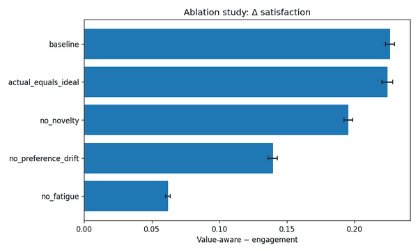

# CTR ≠ пользовательская ценность: как рекомендательная система может идеально оптимизировать не то

Представим удачный A/B-тест: CTR вырос, watch time тоже, пользователи продолжают взаимодействовать с лентой. Модель стала точнее, инфраструктура стабильна, статистика уверенная.

Можно праздновать?

Не обязательно. Есть класс ошибок, в котором система работает **слишком хорошо** — просто оптимизирует не ту величину.

Если наблюдаемое поведение пользователя лишь proxy для результата, который нам действительно нужен, то улучшение proxy ещё не гарантирует улучшения самой цели. Я собрал небольшой воспроизводимый synthetic experiment, чтобы посмотреть на этот механизм в коде: две рекомендательные политики работают в одной среде, но оптимизируют разные objective functions.

Репозиторий с моделью, тестами, sensitivity analysis и ablation study:  
https://github.com/True-Ruslan/recommender-objective-lab

---

## Когда метрика становится целью

Рекомендательной системе проще всего измерять то, что происходит сейчас:

- click;
- dwell time;
- like / share;
- продолжение сессии;
- просмотр следующего объекта.

Это полезные сигналы. Ошибка возникает не здесь, а на следующем шаге — когда удобная метрика незаметно превращается в определение успеха.

Например:

~~~python
engagement_score = (
    0.58 * p_click
    + 0.42 * normalized_dwell
)
~~~

Такая функция отвечает на вполне конкретный вопрос: **какой объект с большей вероятностью вызовет взаимодействие прямо сейчас?**

Но это не то же самое, что вопрос:

> какой объект даст пользователю больше долгосрочной ценности?

В работе *From Optimizing Engagement to Measuring Value* Smitha Milli, Luca Belli и Moritz Hardt [2] формулируют эту проблему через measurement theory: engagement наблюдаем, а интересующий нас value остаётся латентной конструкцией, которую ещё нужно операционализировать.

Есть и production-пример. В RecSys 2024 команда Google [1] описала Learned Ranking Function: система принимает short-term user-item behavior predictions и формирует рекомендации с objective на long-term user satisfaction. Авторы прямо сообщают о live experiments и deployment на YouTube.

То есть различие между «поведением сейчас» и «удовлетворённостью на длинном горизонте» — вполне инженерная постановка задачи.

---

## «Но пользователь ведь сам кликает»

Клик — сильный сигнал. Но не исчерпывающий.

Классический подход часто опирается на revealed preference:

> человек выбрал X → X соответствует его предпочтениям.

Для множества задач это разумное приближение. Но в динамической системе оно не обязано быть полным.

Kleinberg, Mullainathan и Raghavan [4] рассматривают теоретическую модель пользователя с inconsistent preferences и платформу, которая хочет максимизировать user utility, но наблюдает только engagement. В такой постановке рост engagement не обязан означать рост utility.

Есть и экспериментальный результат. В работе *Tailoring recommendation algorithms to ideal preferences makes users better off* [5] рекомендации строили по двум типам предпочтений:

- **actual** — насколько человек *actually* хочет прочитать материал;
- **ideal** — насколько он *ideally* хотел бы его прочитать.

В основном preregistered study участвовали 6488 человек. В primary analysis авторы отдельно рассмотрели случаи, когда actual- и ideal-рекомендации различались (`n=2504`): actual-рекомендацию открывали в 52% случаев, ideal — в 40%. При этом ideal-рекомендации получали более высокие оценки по тому, насколько человек чувствовал себя «better off» и насколько считал время потраченным не зря.

То есть больше кликов и больше субъективной ценности могут быть **разными оптимизационными задачами**.

---

## Feedback loop меняет саму постановку

Recommender — не статический классификатор.

Сегодняшняя рекомендация влияет на то, что система увидит завтра:

~~~text
user state
   ↓
candidate generation
   ↓
ranking objective
   ↓
recommended item
   ↓
click / dwell / satisfaction
   ↓
fatigue + preference update
   ↓
return probability
   └──────────────→ next session
~~~

Пользователь что-то увидел, отреагировал, устал или не устал от категории, вернулся или не вернулся. Policy влияет на future state, а future state — на будущие данные.

Поэтому локально хороший instant reward может иметь стоимость, которая проявится позже.

Saig и Rosenfeld [6] в ICML 2023 моделируют recommendation dynamics через positive и negative feedback и изучают policies, которые предлагают пользователю breaks ради устойчивого long-term engagement. Важно: эмпирическую часть они показывают на **semi-synthetic data**, поэтому переносить результат напрямую на реальную платформу нельзя.

Отдельно Lindström et al. [7] проанализировали 1 046 857 постов от 4168 пользователей нескольких соцплатформ и провели online experiment (`n=176`). Их результаты согласуются с reward-learning account социального поведения. Это не доказательство того, что recommender меняет предпочтения пользователя, но хороший аргумент не считать поведение полностью статичным.

---

# Минимальная модель

Я специально не строил «симулятор YouTube». Без production data и causal identification такой claim был бы незащищаемым.

Задача скромнее:

> можно ли в явной синтетической среде получить систематически разные trajectories только потому, что ranker оптимизирует разные цели?

Reference-конфигурация:

- 400 synthetic users на seed;
- 20 random seeds;
- 8 content categories;
- 1200 items;
- до 12 sessions на пользователя;
- 5 recommendation opportunities на session;
- 20 candidates на каждый ranking step.

У каждого item независимо генерируются category, quality и stimulus. Поэтому в модель не зашито предположение «стимулирующий контент автоматически низкого качества».

У пользователя есть два распределения предпочтений:

- **actual** — текущие непосредственные предпочтения;
- **ideal** — более рефлексивные.

Это не утверждение о человеческой природе, а modelling assumption. Его можно менять и отключать в ablation.

---

## Две objective functions

### Engagement-first

~~~python
engagement_score = (
    0.58 * p_click
    + 0.42 * normalized_dwell
)
~~~

Ranker использует хорошо измеримые immediate signals.

### Value-aware

~~~python
value_score = (
    0.38 * p_click
    + 0.47 * latent_satisfaction
    + 0.15 * novelty
)
~~~

Здесь ranker искусственно получает доступ к broader synthetic outcome.

Это сильное допущение. В production latent satisfaction нельзя просто прочитать из состояния пользователя: её пришлось бы оценивать через surveys, delayed outcomes, learned reward models и другие сигналы.

Поэтому вторая формула — не «правильная». Это контрольная policy, которая оптимизирует **другую цель**.

---

## Что меняется после рекомендации

В модели есть два delayed mechanism.

**Fatigue.** Повторное потребление одной категории создаёт затухающую стоимость — абстракцию насыщения и усталости.

**Preference drift.** Потреблённый контент слегка сдвигает текущие preferences. Это просто state transition, а не тезис о том, что «алгоритм переписывает личность».

В конце session рассчитывается synthetic return probability, зависящая от satisfaction, dwell и накопленного fatigue. Затем цикл повторяется.

---

# Результат: CTR действительно выигрывает по CTR

Reference run: 20 seeds × 400 users.

| Metric | Engagement-first | Value-aware |
|---|---:|---:|
| CTR | **0.702** | 0.607 |
| Satisfaction | 0.682 | **0.908** |
| Mean sessions | 7.53 | **8.83** |
| Diversity | 0.358 | **0.498** |
| Fatigue | 0.153 | **0.129** |
| Preference drift | 0.254 | **0.147** |

Абсолютные значения здесь не следует переносить на реальные продукты. Это synthetic units.

Интересна структура:

- engagement-first получает примерно **+9.5 п.п. CTR**;
- value-aware — примерно **+0.226 synthetic satisfaction**;
- средняя траектория длиннее примерно на **1.30 session**;
- diversity выше;
- fatigue и preference drift ниже.

Первая policy не сломалась. Наоборот — она **успешно оптимизирует именно ту локальную метрику, за которую получает reward**.

---

## Между двумя крайностями есть целая кривая

Чтобы не сравнивать только два endpoint, я ввёл коэффициент alpha:

~~~python
score = (
    (1 - alpha) * engagement_score
    + alpha * value_score
)
~~~

alpha = 0 — engagement-first, alpha = 1 — value-aware.

| alpha | CTR | Satisfaction | Mean sessions |
|---:|---:|---:|---:|
| 0.0 | 0.702 | 0.682 | 7.53 |
| 0.2 | 0.696 | 0.732 | 7.83 |
| 0.5 | 0.672 | 0.813 | 8.37 |
| 0.8 | 0.636 | 0.880 | 8.70 |
| 1.0 | 0.607 | 0.908 | 8.83 |

Для меня это один из главных результатов эксперимента. В реальности вопрос редко выглядит как «CTR или добро». Гораздо чаще это поиск **Pareto frontier** между конфликтующими целями.

---

# Ablation study: какой assumption создаёт эффект?

Красивый результат synthetic model сам по себе мало что значит. Первый вопрос должен быть:

> какой механизм внутри модели его породил?

Я по очереди отключил основные компоненты и посмотрел на разницу value-aware − engagement-first:

| Ablation | Δ CTR | Δ Satisfaction | Δ Mean sessions |
|---|---:|---:|---:|
| Baseline | -0.095 | **+0.226** | **+1.295** |
| No fatigue | -0.049 | **+0.062** | **+0.281** |
| No novelty | -0.052 | +0.195 | +1.151 |
| No preference drift | -0.056 | +0.140 | +0.883 |
| Actual = ideal | -0.104 | +0.224 | +1.270 |

Самое заметное падение происходит при удалении **fatigue**:

- Δ satisfaction уменьшается с +0.226 до +0.062;
- Δ mean sessions — с +1.295 до +0.281.

Я ожидал, что главным фактором окажутся actual/ideal preferences или preference drift. Но в этой среде большую часть divergence создаёт delayed consumption cost.

Это не доказывает, что fatigue — главный механизм реальных платформ. Зато показывает, зачем нужен ablation: он отделяет привлекательную историю от механизма, который действительно двигает результат модели.

---

# Sensitivity analysis: не держится ли всё на одном коэффициенте?

Несколько параметров я прогнал отдельно.

**Preference reinforcement**

- 0.00 → Δ satisfaction ≈ +0.140
- 0.04 → +0.226
- 0.08 → +0.322

Чем сильнее feedback в user state, тем сильнее расходятся policies.

**Fatigue gain**

- 0.00 → Δ satisfaction ≈ +0.062
- 0.10 → +0.151
- 0.22 → +0.226
- 0.35 → +0.214

Зависимость уже не монотонная — модель не сводится к одному линейному трюку.

**Actual / ideal alignment**

Даже при полном actual = ideal gap не исчезает. Значит, baseline result нельзя объяснить только историей про «импульсивные» и «истинные» желания.

Полные таблицы и воспроизводимый запуск лежат в репозитории.

---

# Что это значит для production recommender system

Вывод не в том, что CTR надо перестать считать. CTR, dwell time, conversion и другие immediate metrics крайне полезны.

Но есть несколько инженерных следствий. Причём value-sensitive ranking — не только теоретическая идея: Stray et al. [3] собирают примеры реальных recommender systems, которые модифицировали ради diversity, fairness, well-being, time well spent и factual accuracy.

## 1. Proxy должен оставаться proxy

Если цель — long-term value, полезно явно держать цепочку:

~~~text
business / user objective
        ↓
measurable constructs
        ↓
metrics and learned signals
        ↓
ranking objective
~~~

Проблема начинается, когда последняя строка незаметно подменяет первую.

## 2. Objective function — часть продуктового контракта

Стоит явно фиксировать:

- какие signals входят в ranking;
- за какой horizon они отвечают;
- какие trade-offs допустимы;
- какие guardrails нельзя нарушать;
- кто и на каком основании меняет weights;
- чем измеряется регрессия.

Это делает objective function почти таким же важным интерфейсом системы, как API или schema.

## 3. Нужны метрики разных горизонтов

Если эффект проявляется через неделю, offline AUC модели клика его не увидит.

Полезно разделять:

**Immediate:** CTR, dwell, conversion.  
**Session:** satisfaction proxy, diversity, abandonment, explicit negative feedback.  
**Long horizon:** retention, return quality, survey-based value, regret / hide / unsubscribe.  
**Guardrails:** safety, fairness, content quality, health of the ecosystem.

## 4. User state нельзя считать константой

Как только recommendations влияют на future interactions, ranking становится sequential decision problem.

Не обязательно сразу внедрять full RL. Но даже offline evaluation стоит задавать вопрос:

> что произойдёт с данными и состоянием пользователя, если эту policy применять долго?

Это другой вопрос, чем «насколько хорошо мы предскажем следующий click?».

## 5. Satisfaction — тоже proxy

Фраза «тогда оптимизируем satisfaction» проблему не решает.

Как её измерять: survey, rating, retention, regret, time well spent?

Любой вариант снова является operationalization. От proxy нельзя полностью избавиться — можно лишь сделать его связь с реальной целью более явной, проверяемой и корректируемой.

---

# Что эксперимент не доказывает

Synthetic simulation очень легко превратить в красивое псевдодоказательство, поэтому границы важны.

Эксперимент **не показывает**, что:

- YouTube, TikTok или другая платформа работает по этим equations;
- engagement optimization обязательно вредна;
- preference drift в реальности имеет такую форму;
- synthetic satisfaction — правильное определение welfare;
- выбранные coefficients близки к production;
- value-aware objective всегда лучше.

Он показывает более узкую вещь:

> если measurable proxy не совпадает с desired long-term outcome, оптимизация proxy может выбрать другую policy.

А feedback loops и delayed costs делают эту разницу особенно важной.

---

# Небольшое философское послесловие

У проблемы есть очень старая форма: **средство легко перепутать с целью**.

У Аристотеля в книге I *Никомаховой этики* [8] проводится различие между целями, которые выбираются ради чего-то ещё, и тем, что желанно само по себе. CTR почти идеальный инженерный пример инструментальной величины: нам нужен не клик как таковой, а информация о более важном результате.

Есть и близкая — хотя, конечно, не техническая — православная параллель. В Рим. 7:15–19 [9] апостол Павел описывает конфликт между тем, чего человек хочет как блага, и тем, что фактически делает: «доброго, которого хочу, не делаю». Это не evidence для recommender systems и не тождество с actual/ideal preferences из исследования [5]. Но как интеллектуальная аналогия мысль полезна: **наблюдаемое действие и рефлексивно признаваемая цель не обязаны совпадать**.

В инженерной формулировке всё ещё проще:

> модель не знает, чего мы хотели. Она знает только то, что мы записали в loss, reward или objective.

Чем лучше оптимизатор, тем важнее не ошибиться в последнем.

---

# Вместо вывода

Опасный случай — не только модель, которая плохо предсказывает.

Иногда интереснее система, которая предсказывает **очень хорошо**, но её метрика постепенно становится самостоятельной целью.

Поэтому перед вопросом «какая у нас модель?» полезно задать другой:

> **что именно считается успехом этой модели — и почему мы уверены, что хотели оптимизировать именно это?**

Код, методология, ограничения claims, sensitivity analysis и reference outputs:  
https://github.com/True-Ruslan/recommender-objective-lab

## Литература

1. Wu Y. et al. *Learned Ranking Function: From Short-term Behavior Predictions to Long-term User Satisfaction.* RecSys 2024, pp. 1004–1009. [DOI](https://doi.org/10.1145/3640457.3688184), [arXiv](https://arxiv.org/abs/2408.06512).
2. Milli S., Belli L., Hardt M. *From Optimizing Engagement to Measuring Value.* FAccT 2021, pp. 714–722. [DOI](https://doi.org/10.1145/3442188.3445933), [arXiv](https://arxiv.org/abs/2008.12623).
3. Stray J. et al. *What are you optimizing for? Aligning Recommender Systems with Human Values.* arXiv:2107.10939, 2021; originally presented at the ICML 2020 Participatory Approaches to Machine Learning workshop. [arXiv](https://arxiv.org/abs/2107.10939).
4. Kleinberg J., Mullainathan S., Raghavan M. *The Challenge of Understanding What Users Want: Inconsistent Preferences and Engagement Optimization.* 2022. [arXiv](https://arxiv.org/abs/2202.11776).
5. Khambatta P. et al. *Tailoring recommendation algorithms to ideal preferences makes users better off.* Scientific Reports 13, 9325 (2023). [DOI](https://doi.org/10.1038/s41598-023-34192-x).
6. Saig E., Rosenfeld N. *Learning to Suggest Breaks: Sustainable Optimization of Long-Term User Engagement.* ICML 2023, PMLR 202:29671–29696. [PMLR](https://proceedings.mlr.press/v202/saig23a.html).
7. Lindström B. et al. *A computational reward learning account of social media engagement.* Nature Communications 12, 1311 (2021). [DOI](https://doi.org/10.1038/s41467-020-19607-x).

### Философская и богословская параллель

8. Aristotle. *Nicomachean Ethics*, Book I, especially chapters 1–2 and 7. [Internet Classics Archive](https://classics.mit.edu/Aristotle/nicomachaen.1.i.html).
9. Послание апостола Павла к Римлянам 7:15–19. В православном литургическом контексте этот отрывок входит в чтение Рим. 7:14–8:2. [Orthodox Church in America](https://www.oca.org/readings/daily/2026/06/16/1).
